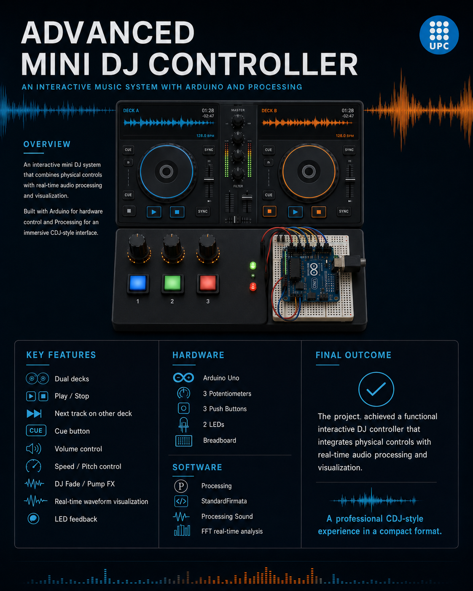

# 🎧 Advanced Mini DJ Controller

Controlador DJ de dos decks que combina controles físicos con **Arduino** y una interfaz de audio y visualización en tiempo real con **Processing**.

Proyecto en equipo: Iker Martínez, Mark Bonete y Marcel Farelo. UPC-ESEIAAT.

## Funcionalidades
- Dos decks virtuales (solo uno suena a la vez, sin solapamiento de audio)
- Play/Stop, siguiente pista en el otro deck y CUE (reinicio)
- Control de volumen y velocidad/pitch con potenciómetros
- Efecto **DJ Fade / Pump** controlado por potenciómetro
- Interfaz estilo CDJ: jog wheels animados, mezclador, vúmetros
- Espectro FFT de 64 bandas en tiempo real
- LEDs de feedback (reproducción y CUE)

## Hardware
| Componente | Pin | Función |
|---|---|---|
| Potenciómetro 1 | A0 | Volumen |
| Potenciómetro 2 | A1 | Velocidad / pitch |
| Potenciómetro 3 | A2 | DJ Fade / Pump FX |
| Pulsador 1 | D4 | Play / Stop |
| Pulsador 2 | D7 | Siguiente pista |
| Pulsador 3 | D8 | CUE |
| LED | D9 | Reproducción |
| LED | D10 | CUE |

Arduino Uno + breadboard + cables. Pulsadores con `INPUT_PULLUP` (un lado a GND, el otro al pin).

## Requisitos
- [Processing 4](https://processing.org/download)
- Librerías de Processing (Sketch → Import Library → Manage Libraries): **Sound** y **Arduino (Firmata)**
- Arduino IDE para cargar `StandardFirmata` (Archivo → Ejemplos → Firmata → StandardFirmata)

## Cómo ejecutarlo
1. Carga **StandardFirmata** en el Arduino y cierra el monitor serie.
2. Abre `mini-dj-controller/mini-dj-controller.pde` en Processing.
3. Crea una carpeta `data` dentro de `mini-dj-controller/` y copia tus propios archivos `.wav`.
4. Edita el array `songs` del código con los nombres de tus archivos.
5. Conecta el Arduino y pulsa ▶.

> Los audios no se incluyen por derechos de autor.

## Retos resueltos
- Detección automática del puerto serie
- Suavizado de potenciómetros con `lerp()` y umbral de ruido
- Evitar solapamiento de audio al cambiar de pista
- Rediseño del mezclador para evitar solapamientos

## Mejoras futuras
Mezcla simultánea de dos pistas, crossfader, efectos (eco, reverb), sincronización BPM, LEDs RGB y carcasa física.

## Documentación
Presentación del proyecto: [docs/presentacion.pdf](docs/presentacion.pdf)
